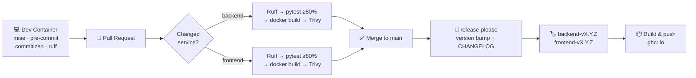
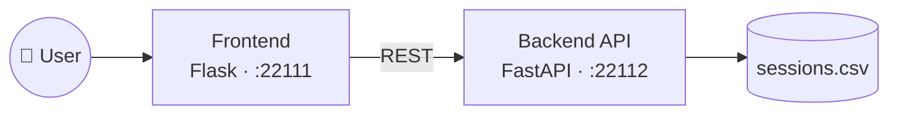

<div align="center">

# 🚀 DevOps Study Tracker: CI/CD Platform

**A two-service Python app used as a real target for a full DevOps workflow: containerized dev environment, PR quality gates, security scanning, automated semantic releases and image publishing to GHCR.**


</div>

---

## 🎯 What this project shows

The app is intentionally simple: log study minutes with a tag, list them, see stats. **The point is everything around it**, which is how a team would build, test, secure, version and ship two services from one monorepo.

| Capability | How it's done here |
| --- | --- |
| **Reproducible dev environment** | Dev Container + DevPod, tool versions pinned with **mise**, Docker-in-Docker, auto-setup hooks |
| **PR quality gates** | GitHub Actions run **only for the service that changed** (path filters): Ruff lint + format check, pytest with an **80% coverage gate**, coverage posted as a PR comment |
| **Container security** | Every PR builds the image and scans it with **Trivy** (CRITICAL/HIGH, OS + library) |
| **Hardened images** | Multi-stage builds on **Alpine**, only the virtualenv shipped (no source, no build tools), **non-root user** (UID 1000), uv cache mounts for fast builds |
| **Semantic releases** | **Conventional Commits** enforced by commitizen → **release-please** opens release PRs, bumps versions, writes CHANGELOGs, tags each service independently |
| **Image publishing** | A `backend-v*` / `frontend-v*` tag triggers build & push to **GitHub Container Registry**, tagged with the version and `latest` |
| **Ops-ready services** | `/health` endpoints (frontend reports API connectivity, returns 503 if the backend is down), 12-factor config through environment variables |

---

## 🔄 Pipeline



| Workflow | Trigger | Does |
| --- | --- | --- |
| [`backend-test.yaml`](.github/workflows/backend-test.yaml) | Pull request touching `src/backend/**` | Lint, format check, tests + coverage gate, PR coverage comment, image build, Trivy scan |
| [`frontend-test.yaml`](.github/workflows/frontend-test.yaml) | Pull request touching `src/frontend/**` | Same gates for the frontend |
| [`release-please.yaml`](.github/workflows/release-please.yaml) | Push to `main` | Release PRs, version bumps, changelogs and per-service tags (uses a GitHub App token so the tag can trigger the next workflow) |
| [`docker-build-push.yaml`](.github/workflows/docker-build-push.yaml) | Tag `backend*` / `frontend*` | Builds and pushes `study-app-backend` / `study-app-frontend` to GHCR |

---

## 🏗️ Architecture



**Backend API** (`src/backend`, FastAPI)

| Method | Endpoint | Purpose |
| --- | --- | --- |
| `GET` | `/health` | Liveness check (built for Kubernetes probes) |
| `POST` | `/sessions` | Log a study session (`minutes`, `tag`) |
| `GET` | `/sessions` | List sessions, optional tag filter |
| `GET` | `/stats` | Aggregated study statistics |

**Frontend** (`src/frontend`, Flask + Jinja templates): web UI to add and view sessions. `/health` also checks that the backend can be reached.

---

## ⚡ Quick start

**Option 1: Dev Container (recommended).** Open the repo in DevPod or VS Code Dev Containers. `mise` installs Python, uv, ruff, trivy and pre-commit, and the setup script installs the git hooks.

**Option 2: pull the published images**

```bash
docker network create study
docker run -d --name backend  --network study -p 22112:22112 ghcr.io/itsmamoroso/study-app-backend:latest
docker run -d --name frontend --network study -p 22111:22111 \
  -e API_URL=http://backend:22112 ghcr.io/itsmamoroso/study-app-frontend:latest
# open http://localhost:22111
```

**Option 3: run locally with uv**

```bash
cd src/backend  && uv sync && uv run study-tracker-backend    # :22112
cd src/frontend && uv sync && uv run study-tracker-frontend   # :22111
```

### Configuration

| Variable | Service | Default |
| --- | --- | --- |
| `API_PORT` / `API_HOST` | backend | `22112` / `0.0.0.0` |
| `DATA_DIR` | backend | `src/data` |
| `CORS_ALLOW_ORIGINS` / `_METHODS` / `_HEADERS` | backend | `*` (comma-separated list) |
| `API_URL` | frontend | `http://localhost:22112` |
| `FRONTEND_PORT` / `FRONTEND_HOST` | frontend | `22111` / `0.0.0.0` |
| `API_TIMEOUT` | frontend | `5` seconds |

---

## 🧪 Testing

```bash
cd src/backend && uv run pytest --cov=src/backend --cov-fail-under=80
```

32 tests across both services: API routes, storage layer and config (backend); routes and API failure handling with mocked HTTP (frontend).

---

## 📁 Repository layout

```text
test-dev/
├── .devcontainer/          # Ubuntu 24.04 + mise + Docker-in-Docker
├── .github/workflows/      # PR gates, release-please, GHCR publishing
├── scripts/                # Dev environment bootstrap
├── src/
│   ├── backend/            # FastAPI service, Dockerfile, tests, CHANGELOG
│   └── frontend/           # Flask service, Dockerfile, tests, CHANGELOG
├── mise.toml               # Pinned toolchain
├── .pre-commit-config.yaml # commitizen + ruff hooks
└── release-please-config.json
```

---

## 🗺️ Roadmap

- [ ] Deploy to Kubernetes in my upcoming **[homelab](https://github.com/itsmamoroso/homelab)**
- [ ] GitOps deployment repo
- [ ] Make Trivy blocking on CRITICAL findings

<div align="center">

Built by **[Marco Antonio Amoroso](https://github.com/itsmamoroso)** · building DevOps skills in public

</div>
